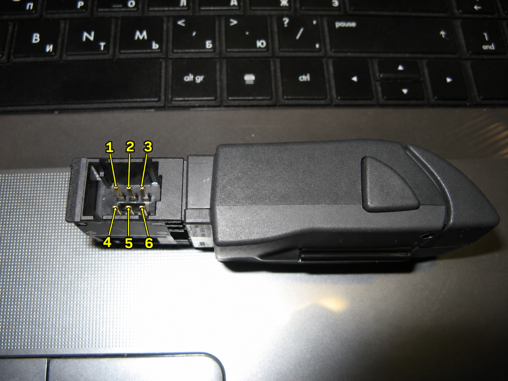

# Renault 255522448R decoder

Распиновка, сканер контактов и декодер подрулевого пульта мультимедиа
**Renault 255522448R**. Проверено на подключённом экземпляре 8 ноября 2026 года:
пять кнопок, направления колеса и два сочетания кнопок.

English: measured pinout and USB contact scanner for a Renault multimedia stalk,
part number **255522448R**, with a Python decoder and recorded bench tests.

## Что здесь работает

- STM32F103 сканирует связи между шестью проводами и передаёт маску через USB CDC.
- Python распознаёт громкость +/−, трубку, Source Audio, Mode/OK и колесо.
- Дополнительно различаются **VOL+ вместе с VOL−** и **две верхние кнопки вместе**.
- Можно читать реальный пульт или воспроизводить приложенные JSON-журналы без железа.

Это стенд чтения пульта. KEY1/KEY2 магнитолы, USB HID и выдача медиакоманд
в этом отдельном репозитории не реализованы. Рабочие измерения сделаны исходной
прошивкой `bench`; выделенный здесь сканер собран отдельно и требует своей
проверки на железе. Текущую плату автоматически не перепрошивали при оформлении.

## Пульт и нумерация разъёма



[Исходная фотография без аннотации](docs/images/connector-reference.png).
Номерная иллюстрация подготовлена ImageGen; исходник сохранён отдельно.

Вид **внутрь разъёма самого пульта**, как на фотографии:

```text
1  2  3
4  5  6
```

Это согласованная нумерация данного проекта, а не заявление о заводских
номерах контактов Renault. Ответная колодка со стороны проводов может быть
зеркальной. Фото предоставлено пользователем из сторонней статьи; точный
URL оригинала и автор фотографии пока не установлены.

| Контакт | Вход STM32 | Участие в контактах |
|---|---|---|
| 1 | PB4 | VOL+, один из контактов колеса |
| 2 | PB5 | Общий контакт колеса |
| 3 | PB6 | Трубка, Mode/OK, контакт колеса |
| 4 | PB7 | Общая линия VOL+, VOL− и Mode/OK |
| 5 | PB8 | Общая линия двух верхних кнопок |
| 6 | PB9 | VOL−, Source Audio, контакт колеса |

Здесь нет отдельной земли пульта: это матрица сухих контактов. Все шесть
проводов участвуют в сканировании. На отключённый пульт не подают 12 В.

## Проверенная карта кнопок и колеса

| Элемент | Прямое замыкание | Имя в программе |
|---|---|---|
| Громкость + | 1–4 | `VOL_PLUS` |
| Громкость − | 4–6 | `VOL_MINUS` |
| Верхняя правая, приём/завершение звонка | 3–5 | `PHONE` |
| Верхняя левая, Source Audio | 5–6 | `SOURCE_AUDIO` |
| Нижняя, Mode/OK | 3–4 | `MODE_OK` |
| Колесо | 2–3 / 2–6 / 2–1 | `WHEEL_UP` / `WHEEL_DOWN` |

При движении **вверх** наблюдался цикл `2–3 → 2–6 → 2–1 → 2–3`.
При движении **вниз** — обратный. Между контактами бывают разрывы;
это не обычный двухканальный квадратурный энкодер A/B.
Названия и расположение кнопок уточнялись пользователем на стенде.

Декодер сравнивает **полную связность**, а не только наличие одной пары:
если 2–6 замкнуто колесом, а 4–6 кнопкой, видны все три связи
2–6, 4–6 и косвенная 2–4. Это одна кнопка, а не три.

## Дополнительные сочетания

| Сочетание | Прямые замыкания | Имя |
|---|---|---|
| VOL+ и VOL− | 1–4 и 4–6 | `VOL_BOTH` |
| Source Audio и трубка | 5–6 и 3–5 | `TOP_BOTH` |

Оба сочетания дают отдельные состояния, отличимые от одиночных кнопок и
от одного колеса. Их можно использовать как дополнительные команды;
конкретные действия пользователь назначает отдельно.

**Ограничение:** зажатые VOL+ и VOL− соединяют 1, 4 и 6. Поэтому колесо,
замкнувшее 2–1, электрически не отличается от колеса, замкнувшего 2–6.
У двух верхних кнопок аналогично сливаются положения 2–3 и 2–6.
Декодер сохраняет распознавание сочетания, но не выдаёт направление колеса
при удержании сочетаний и не переносит предыдущее направление через них.

Это проверено отдельным 20-секундным прогоном: при зажатых VOL+ и VOL−
и вращении вверх-вниз были только `2155`, `2034`, `2014` (и исходное/конечное
состояние одного колеса). Декодер дал одно нажатие `VOL_BOTH` и одно отпускание,
без ложных одиночных кнопок. Подробности — [в стендовом журнале](docs/bench-notes.md).

Произвольные одновременные нажатия не гарантируются: диодов развязки внутри
нет, разные комбинации могут давать одинаковый граф. При постепенном нажатии
двух кнопок сначала может появиться событие одиночной кнопки, затем сочетания.
Для назначения конечных действий понадобится политика ожидания сочетания.

## Подключение стенда

1. Полностью отключить пульт от штатной электроники.
2. Соединить контакты 1–6 с PB4–PB9 соответственно, каждый через отдельный
   последовательный резистор около 1 кОм. Землю пульта отдельно не назначать.
3. Подключить USB Blue Pill к компьютеру: питание и CDC-порт.
4. Для прошивки: ST-LINK SWDIO → PA13, SWCLK → PA14, GND → GND, BOOT0=0.
   При питании от USB не соединять выход питания программатора с питанием платы.
   Если у программатора есть отдельный вход опорного напряжения, подключать
   его согласно документации именно этого программатора.

Сканер оставляет пять линий входами с подтяжкой к 3.3 В и по очереди
переводит шестую в open-drain LOW. Конфликтующих push-pull уровней нет.
JTAG отключён для использования PB4, SWD остаётся доступным.

## Запуск на компьютере

Python 3.10+; для живого порта нужен `pyserial`, для воспроизведения — только
стандартная библиотека. Пример из корня этого репозитория:

```powershell
python -m pip install -r requirements.txt
python tools/stalk.py --port COM5 --seconds 30 --output captures/local-test.json
```

Под Linux вместо COM5 укажите свой порт, например `/dev/ttyACM0`.
Существующий выходной файл не перезаписывается. Прерывание — Ctrl+C,
полученные строки сохраняются. Одновременно порт может открыть одна программа.

Без подключения пульта:

```powershell
python tools/stalk.py --replay captures/rapid-volume-20261108-015829.json
python tools/stalk.py --replay captures/wheel-five-each-20261108-015952.json
python -m unittest discover -s tests -v
```

События `PRESS_…` и `RELEASE_…` описывают изменения кнопок. `INITIAL_…` —
состояние на старте, которое не считается новым нажатием. `UNKNOWN` —
неподдерживаемый граф; программа не пытается угадать команду.
`WHEEL_UP/DOWN` — переходы между наблюдаемыми положениями, не гарантированное
число механических щелчков при любой скорости.

## Прошивка сканера

Blue Pill с STM32F103C6T6A, кварц 8 МГц, USB PA11/PA12.
Консервативные пределы: 32 КБ Flash и 6 КБ RAM.

```powershell
python -m pip install platformio==6.2.0
pio run -d firmware
pio run -d firmware -t upload
```

Прошивка через ST-LINK, не через CDC-разъём самой платы.
USB-команды: `PING`, `STATE`, `RAW ON`, `RAW OFF`, `HELP`.
У самостоятельного сканера нет включаемого профиля и выходов на магнитолу.
Он использует демонстрационные USB VID/PID для локального прототипа,
не зарегистрированную идентичность коммерческого устройства.

## Результаты проверок

| Проверка | Наблюдение |
|---|---|
| Пять кнопок по отдельности | Все различены, карта выше |
| Смешанный прогон | Кнопки и колесо читаются при разных положениях |
| Только колесо, 25 секунд | Ложных кнопочных состояний не наблюдалось |
| 10 нажатий VOL+, затем 10 VOL− | Получено ровно 10 + 10 |
| 5 шагов вверх, затем 5 вниз | Получено 5 переходов вверх, затем 5 вниз |
| VOL+ и VOL− вместе | Стабильное отдельное сочетание |
| Две верхние вместе | Стабильное отдельное сочетание |
| VOL+ и VOL− удерживаются при вращении колеса | Одно удержание сочетания, без ложных одиночных кнопок; направление колеса неоднозначно |

Опрос матрицы — примерно раз в 1 мс, выдача `RAW` — после **20 мс стабильности**.
`STATE raw=` возвращает текущий скан и сам по себе не обещает эти 20 мс.
Нестабильный/несимметричный скан обозначается `FFFF`.
Записи уже отфильтрованы: они не доказывают отсутствие физического дребезга,
коротких импульсов или пропусков при быстром вращении. Темп теста кнопок —
примерно одно нажатие в 0.65–0.82 с. Последние два перехода вверх в тесте колеса
пришли с интервалом около 40 мс; совпадение итогового счёта не доказывает
однозначное соответствие каждого перехода механическому щелчку.

[Подробные стендовые заметки](docs/bench-notes.md) ·
[Оригинальные журналы](captures/) · [Источники](docs/sources.md).

Общая лицензия проекта пока не выбрана. Происхождение стороннего USB-кода
и фотографии указано в [THIRD_PARTY.md](THIRD_PARTY.md); сторонние материалы
не следует считать автоматически покрытыми лицензией собственного кода.
